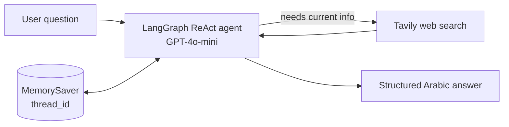

# Hadaf Certifications Agent

An Arabic-first AI agent that answers questions about professional certifications supported by HRDF (Hadaf): which certification fits a field, what it costs, and how to request reimbursement.

**Status:** experimental prototype in a single Colab notebook. Personal project.

<a href="https://colab.research.google.com/github/taifl2/hadaf-certifications-agent/blob/main/Hadaf_AI_Certifications_Advisor.ipynb"></a>

## Problem

HRDF reimburses a range of international professional certifications, but what a job seeker needs to know (which certifications are covered, exam fees, reimbursement amounts, how to apply) is spread across several pages. Getting a clear answer means searching, comparing, and reading program terms one by one.

## Solution

A conversational agent that searches the web for current information and replies in Arabic using a fixed answer structure. Because it keeps conversation memory, a user can ask follow-up questions ("does it suit someone without programming experience?", "how much will Hadaf reimburse?") without repeating which certification they mean.

## Features

- Live web search through Tavily (up to 5 results per search)
- Structured Arabic answers: certification and issuer, why it matters, HRDF support status and fees, how to apply for reimbursement, and the official HRDF program link
- Multi-turn memory per session using a LangGraph checkpointer
- API keys are read from environment variables or entered at runtime with `getpass`, never stored in the notebook

## Architecture



The agent is built with LangGraph's prebuilt `create_react_agent`. A system prompt defines the advisor role and the answer format. `MemorySaver` stores the message history under a `thread_id`, so each conversation keeps its own context.

## Technologies

| Component | Tool |
|---|---|
| Agent framework | LangGraph (`create_react_agent`, `MemorySaver`) |
| Language model | OpenAI GPT-4o-mini, temperature 0.2 |
| Web search | Tavily via `langchain-community` |
| Environment | Google Colab / Jupyter |

## Project structure

```
.
├── Hadaf_AI_Certifications_Advisor.ipynb   # the agent and example conversations
├── requirements.txt                        # packages the notebook imports
└── README.md
```

## Installation

You need an OpenAI API key and a Tavily API key.

**Colab (recommended):** click the badge above. The first cells install the dependencies.

**Locally:**

```bash
git clone https://github.com/taifl2/hadaf-certifications-agent.git
cd hadaf-certifications-agent
python -m venv .venv && source .venv/bin/activate
pip install -r requirements.txt jupyter
```

## How to run

1. Set `OPENAI_API_KEY` and `TAVILY_API_KEY` as environment variables, or let the notebook prompt for them.
2. Run the cells in order.
3. Change the `question` variable (or the messages in the memory cells) to ask your own questions.

Example questions used in the notebook:

- وش أفضل شهادة للذكاء الاصطناعي؟
- هل تناسب شخص ما عنده خبرة برمجية؟
- كم بالضبط يعوضني هدف عنها بالريال وكيف أرفع الفاتورة؟

## Example output

Not included yet. The notebook is committed without saved outputs; a recorded example conversation will be added here.

## Limitations

- Answers depend on whatever the web search returns. Search is not restricted to hrdf.org.sa, so fees and reimbursement amounts must be checked on the official HRDF site.
- No evaluation of answer accuracy yet.
- Memory lives in RAM and is lost when the notebook restarts.
- No error handling for failed API calls or missing results.
- Notebook only, no user interface yet.

## Future improvements

- Restrict search to official sources (`include_domains`) and show the source URL with each answer
- A small evaluation set of known certification questions to measure accuracy
- Move the agent into a Python module with a simple chat interface

## Author

Taif Al-Anzi · [LinkedIn](https://www.linkedin.com/in/taif-alanzi-is/)
